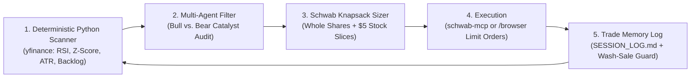

# AI-Powered Retail Investing & Recurring Portfolio Growth Plan (<$1,000 Blueprint)

**Prepared:** 2026-11-05  
**Account Context:** Charles Schwab (`~$60` current value, scaling toward `<$1,000` via low-stakes recurring deposits)  
**Installed Workspace Stack:** 119 Quantitative & ML4T Agent Skills + `schwab-mcp` (pending 1–3 day developer approval) + Browser Execution Assistant

---

## Part 1: Deep Research — How Retail Traders Actually Use AI in 2026

The landscape of retail AI investing has shifted away from asking chatbots *"What stock should I buy?"* toward **hybrid deterministic-agentic workflows**. Across open-source communities (`TradingAgents`, `ai-hedge-fund`, `Lumibot`, and Model Context Protocol ecosystems), five practices separate profitable retail AI setups from novelty toys:

### 1. "Math First, LLM Second" (Deterministic Quant + Qualitative Synthesis)
- **Why Naive AI Fails:** LLMs hallucinate numbers and are bad at mental arithmetic on raw price arrays.
- **How Winning Retail Traders Do It:** A lightweight Python script (`yfinance` + `pandas`) deterministically calculates **14-day RSI**, **20-day Z-score (mean reversion)**, **ATR volatility**, and **drawdown from 20-day highs**. The AI agent only reads those verified numbers and combines them with what LLMs are uniquely great at: **parsing SEC 8-K filings, hyperscaler lease announcements, megawatt buildout timelines, and earnings call transcripts**.

### 2. Model Context Protocol (MCP) Broker Copilots (`schwab-mcp`)
- Instead of blind autonomous bots that can Drain an account on a bad prompt, retail traders use **MCP servers** (`jkoelker/schwab-mcp`) in a **Human-in-the-Loop Copilot** pattern.
- The agent inspects live balances, cost basis, and bid/ask spreads automatically, proposes an exact limit-order basket, and executes only when you approve (or within strict hard-coded dollar limits).

### 3. Multi-Agent Adversarial Debate (`ml4t-multi-agent-forecasting`)
- Single-prompt AI agents suffer from **sycophancy and bullish bias**—if you ask whether a dip is a buy, a single agent will almost always say yes.
- Best-in-class retail workflows (`TauricResearch/TradingAgents` and our installed `ml4t-multi-agent-forecasting` skill) run a quick 3-role check before buying any dip:
  1. **Bull Agent:** Quantifies contracted backlog vs. market cap (e.g., `APLD`'s $36B backlog vs. ~$3B market cap).
  2. **Bear / Skeptic Agent:** Checks if the dip was caused by a **thesis-breaker** (e.g., a canceled hyperscaler lease, toxic dilution, or accounting restatement) vs. normal sector beta.
  3. **Risk & Sizing Agent:** Enforces hard portfolio caps (no single stock > 25% of portfolio once above $250; respects Schwab settled-cash rules).

### 4. Playing Where Retail Has Structural Edge (Swing & Bottleneck Accumulation vs. HFT)
- Retail traders cannot beat institutional high-frequency algorithms on 5-minute charts.
- Where retail AI workflows **thrive** is **multi-week swing trading and secular bottleneck accumulation**—buying 10%–25% panic pullbacks on companies with multi-billion-dollar contracted hyperscaler backlogs (`IREN`, `APLD`, `WULF`, `CORZ`, `CIFR`, `CLSK`) and trimming into extreme overbought spikes (like your **+45.4% realized gain on `IMPP`**).

### 5. Outcome-Weighted Trade Memory (`trade-journal` & `SESSION_LOG.md`)
- Retail AI traders maintain a persistent markdown/JSON memory log (`SESSION_LOG.md`) that tracks **why** every trade was entered, what the RSI/Z-score was at entry, and what platform rules applied (such as Schwab's sub-$1.00 cleared-cash rule discovered today on `BTBT`).

---

## Part 2: Overcoming Charles Schwab's Specific Micro-Account Constraints (<$1,000)

Running a `<$1,000` portfolio on Charles Schwab has four specific platform rules that our AI workflow automatically solves for you:

| Schwab Constraint | How It Affects a <$1,000 Account | Our AI Workflow Solution |
| :--- | :--- | :--- |
| **1. Whole Shares Required for Non-S&P 500 Stocks** | Mid/small-cap AI landlords (`IREN`, `APLD`, `WULF`, `CIFR`, `CLSK`, `HIVE`) must be bought in whole shares. | Use a **Knapsack Exact-Change Allocator** that pairs `$10–$20` Tier-1 shares with `$1.50–$6.00` sweeper shares (`HIVE`, `EOSE`, `POET`, `CLSK`) to deploy **98%–99.9%** of every deposit. |
| **2. Schwab *Stock Slices* ($5 Min for S&P 500)** | S&P 500 AI giants (`NVDA` ~$190, `AVGO` ~$310, `VRT` ~$185, `ANET` ~$165) are too expensive for whole shares on a $50 deposit. | Use **Schwab Stock Slices ($5.00 minimum)** during regular market hours to buy exact `$5.00–$10.00` fractional slices of `NVDA`, `AVGO`, `ANET`, or `VST`/`CEG`! |
| **3. Sub-$1.00 Penny Stock Cleared-Cash Rule** | Stocks under `$1.00` (like `BTBT` at `$0.70`) **cannot** be bought with newly transferred (unsettled) ACH cash—Schwab requires 100% settled cash. | Whenever investing a fresh ACH transfer on Day 1, our allocator automatically uses **above-$1.00** sweepers (`HIVE` ~$1.63 or `EOSE` ~$1.82) and saves sub-$1.00 `BTBT` orders for settled cash days. |
| **4. T+1 Settlement & Good Faith Violations (GFV)** | In a cash account (or <$25k account avoiding Pattern Day Trader limits), selling a stock bought with unsettled funds before the deposit clears causes a Good Faith Violation. | Hold new dip-buys for at least **3–5+ trading days** (swing horizon), never day-trading unsettled deposits. |

---

## Part 3: Your Recurring Sub-$1,000 Portfolio Growth Plan ("The 60 / 20 / 20 Pyramid")

Whether you toss in **$25 every two weeks** or **$50 whenever AI stocks have a red day**, we organize your `<$1,000` fun portfolio into three clear buckets:

### Bucket 1: Tier-1 Hyperscaler AI Landlords (60% Target Weight)
*Whole shares (`$5–$25/sh`). Backed by $6B to $86B in signed 15-to-20 year hyperscaler leases.*
- **`IREN` (~$18.30):** Microsoft 200 MW liquid-cooled campus + 480 MW AI Cloud.
- **`APLD` (~$14.00):** $36B base ($86B max) hyperscaler leases across 1,410 MW.
- **`CORZ` (~$14.30):** CoreWeave (590 MW) + AMD (530 MW), $215M/qtr live colocation revenue.
- **`WULF` (~$10.10):** $19B–$33B 20-year Anthropic lease + Google-backed Fluidstack (839 MW).
- **`CIFR` (~$5.55) & `CLSK` (~$5.67):** High-backlog sub-$8 landlords ($16.6B and $6.6B–$11.6B contracted).

### Bucket 2: S&P 500 Blue-Chip AI Compounders via *Stock Slices* (20% Target Weight)
*Bought in exact **$5.00 or $10.00 slices** on Schwab (`Trade` -> `Schwab Stock Slices`) during regular market hours.*
- **`NVDA` (NVIDIA)** & **`AVGO` (Broadcom):** The silicon brains of every AI data center.
- **`ANET` (Arista Networks):** High-speed AI Ethernet switching.
- **`VST` (Vistra) / `CEG` (Constellation Energy):** S&P 500 nuclear & natural gas baseload power generators signing 20-year deals with Microsoft and Meta.

### Bucket 3: High-Asymmetry Pick-and-Shovels & Cash Sweepers (20% Target Weight)
*Whole shares (`$0.70–$5.00/sh`) used to capture asymmetric upside AND soak up the leftover `$1–$5` change on every deposit.*
- **`POET` (~$4.30–$5.00):** 800G/1.6T optical interposers for AI GPU clusters.
- **`EOSE` (~$1.82):** $765M (3.2 GWh) zinc battery storage backlog for grid/data center backup power.
- **`HIVE` (~$1.63):** NVIDIA Blackwell `GB300 NVL72` GPU cloud (`BUZZ HPC`, $350M contract).
- **`BTBT` (~$0.70):** Enovum Tier-3 Montreal data centers + Cerebras AI cloud *(buy only with settled cash)*.

---

## Part 4: Your "Red-Day Dip Hunter" Rules

Your rule is crystal clear: **Only buy when AI & data center stocks are RED; skip buying on green days (and use big green spikes to harvest cash for the next red day).**

[`scripts/ai_portfolio_scanner.py`](/Users/bradjensen/stock/scripts/ai_portfolio_scanner.py) enforces five quantitative gates every time we check the market:

| Gate | Trigger Condition | Action on Charles Schwab |
| :--- | :--- | :--- |
| **1. Green Day Filter (`1D % >= 0%`)** | Stock is green today | **SKIP BUY.** Never chase green candles; keep cash dry for a red session. |
| **2. Landlord Flash Sale (`1D % <= -5.0%` or `Z <= -1.25`)** | `IREN`, `APLD`, `WULF`, `CORZ`, `CIFR`, or `CLSK` drops **5%+ in a day** (or RSI < 40) | **FLASH BUY (Whole Share):** Top priority. First unlock any unowned landlord (**`CORZ`** is the final unowned Big-6 landlord!), then add to the deepest red Dip Score. |
| **3. S&P 500 Red Day (`1D % <= -3.0%`)** | `NVDA`, `AVGO`, `VRT`, `ANET`, or `VST` drops **3%+ in a day** | **STOCK SLICE BUY (`$5.00`):** Grab a `$5.00` Schwab Stock Slice during regular trading hours. |
| **4. Red Change Sweeper (`$1.00–$4.99` left)** | `POET`, `EOSE`, or `HIVE` is red (`>$1.00` works on unsettled ACH cash; `BTBT` once cash settles) | **CASH SWEEP:** Mop up leftover `$1.50–$4.99` change so **97%–99.9%** of your transfer is invested at red-day prices. |
| **5. Green-Day Cash Reload (`+35%` & `RSI >= 68`)** | Existing holding rallies **+35%+ above your cost basis** on a big green day | **HARVEST 1 SHARE:** Trim 1 share into strength so you have settled cash waiting inside Schwab for the *next* red day without even needing a new bank transfer! |

### Your Priority Queue for the Next Red Day (Plus Your `$1.40` Carryover Cash)
Since you now own **`1x IREN`**, **`1x APLD`**, **`1x WULF`**, **`1x CIFR`**, **`1x CLSK`**, **`2x HIVE`**, and **`2x BTBT`**:
1. **`CORZ` (~$14.30):** The last unowned Tier-1 landlord (590 MW CoreWeave + 530 MW AMD).
2. **`POET` (~$4.50) & `EOSE` (~$1.82):** Unowned pick-and-shovels (800G/1.6T optical GPU interposers + 3.2 GWh data center zinc battery storage).
3. **`NVDA` / `VRT` / `AVGO` (`$5.00` Stock Slice):** On the next -3% Nasdaq pullback during regular market hours.

---

## Part 5: Growth Roadmap from $60 to $1,000

| Milestone | Portfolio Size | Key Unlock at This Stage |
| :--- | :---: | :--- |
| **Stage 1 (Today)** | **`~$60`** | Own the core AI landlord basket (`CIFR`, `HIVE`, `BTBT`, `IREN`, `APLD`, `WULF`, `CLSK`). Wait 1–2 more business days for `developer.schwab.com` (`Ready For Use`) to connect `schwab-mcp`. |
| **Stage 2** | **`$150 – $300`** | Add **`CORZ`** (CoreWeave/AMD landlord) and **`POET`** (optical interconnects), plus start your first **$5.00 Schwab Stock Slices** in **`NVDA`** and **`AVGO`**. |
| **Stage 3** | **`$300 – $600`** | Activate the **+35% Harvest Ratchet**—trimming 1 share of whichever AI landlord spikes on earnings/lease news and rotating into lagging peers. |
| **Stage 4** | **`$600 – $1,000`** | Full 10–12 position AI & Power ecosystem portfolio with automated weekly tearsheets logged in `/Users/bradjensen/stock/artifacts/`. |
